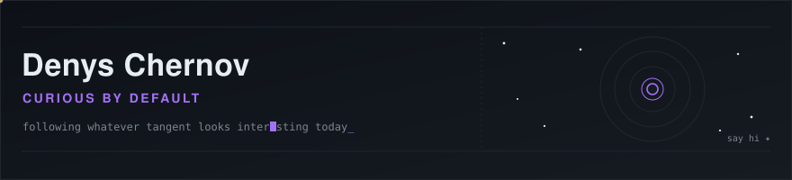
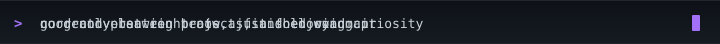

  

  

---

Hi, I'm Denys. I like taking things apart to see how they work, and usually end up building something a little different from what I set out to make.

There's no flagship project pinned here right now — I'm between things at the moment, which is its own kind of fun. Mostly reading, poking at ideas, following whatever thread looks interesting that day.

A few things that are generally true about me:

- I'd rather understand something slowly than ship it fast
- Good questions are more interesting to me than finished answers
- I'm drawn to systems and patterns — in code, but also well outside of it
- Always happy to talk about a weird idea, even a half-formed one

### 📊 Activity

  
  

  

### Say hi

Open an issue, start a discussion, or just drop by — I don't bite.

---

Curious · Still figuring it out · Building quietly
